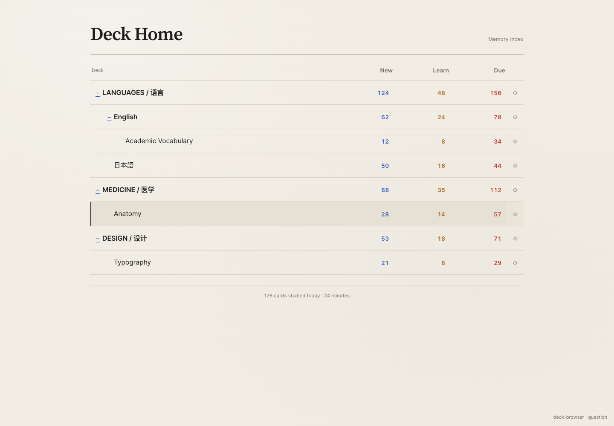
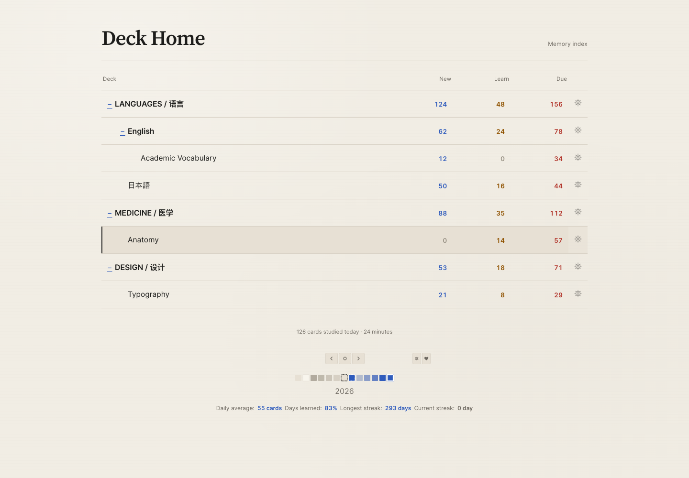
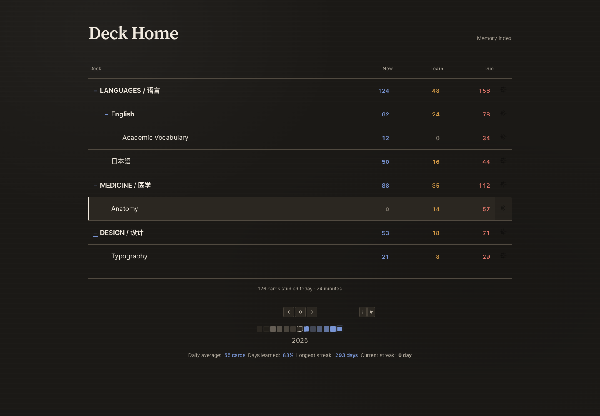
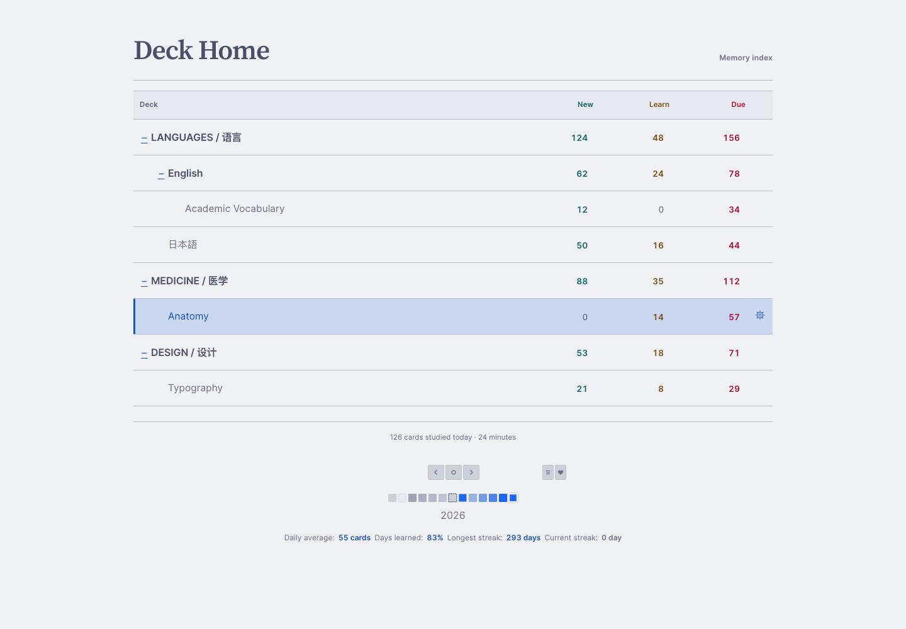
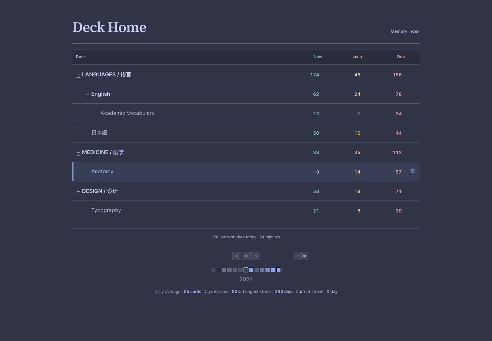
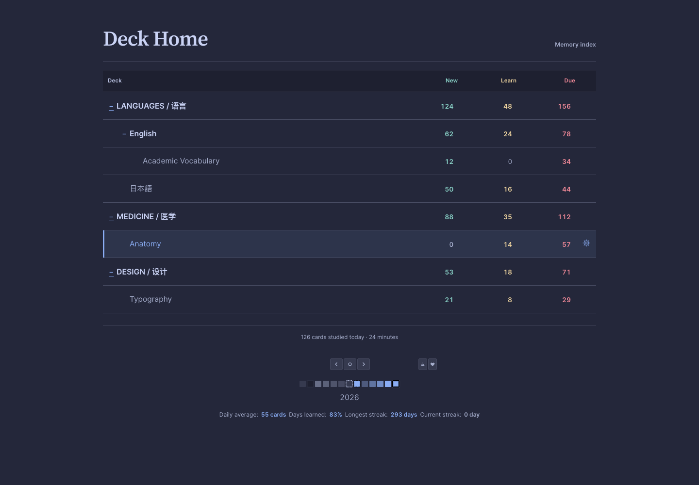
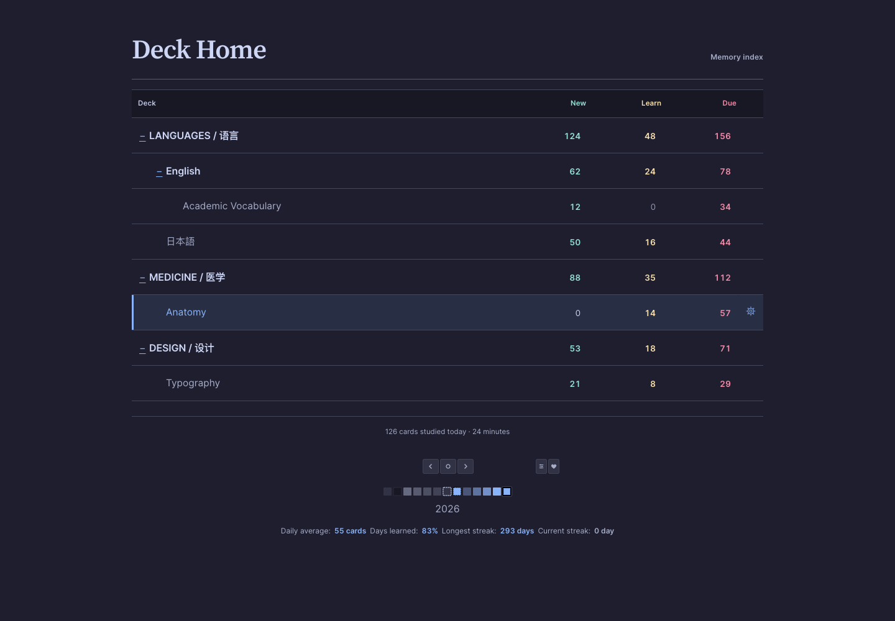
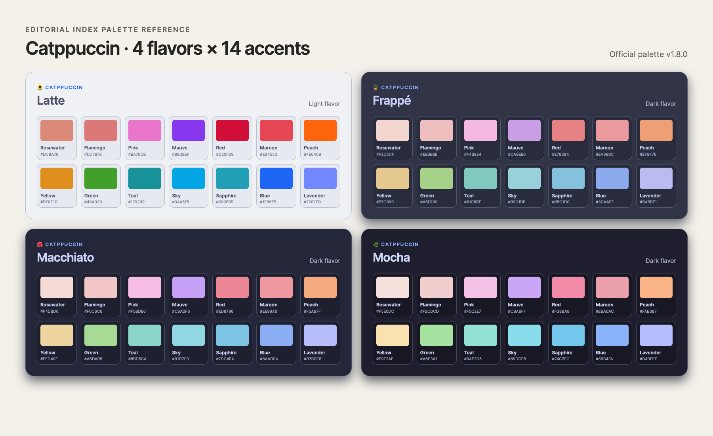
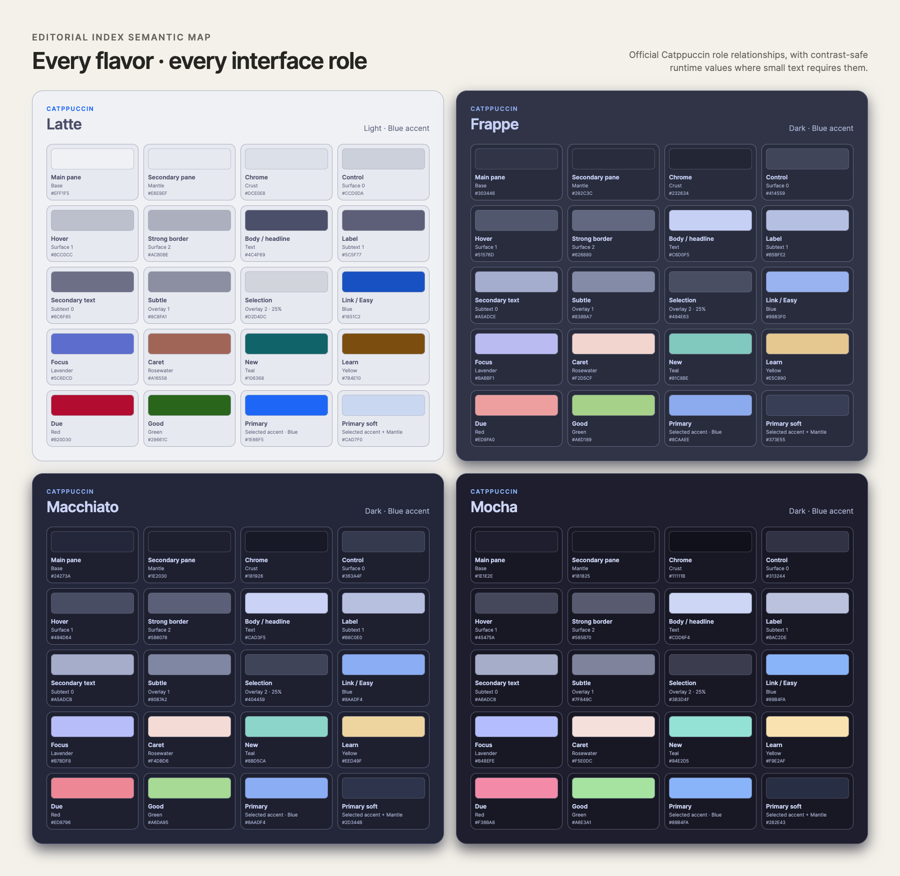

<div align="center">

# Editorial Index

An editorial desktop theme for Anki with warm-paper and Catppuccin palettes

[中文](./README.md) · [Download](https://github.com/Damon-GSY/anki-editorial-index/releases/latest) · [Configuration](./docs/CONFIGURATION.md) · [Troubleshooting](./docs/TROUBLESHOOTING.md)

[](https://github.com/Damon-GSY/anki-editorial-index/releases/latest)
[](https://apps.ankiweb.net/)
[](./LICENSE)

</div>



Editorial Index restyles Anki Desktop's deck browser, reviewer shell, navigation, and standalone Add, Browse, Stats, Deck Options, and Preferences windows. It leaves your collection, scheduling, shortcuts, and card templates intact.

## Install

1. Open the [latest release](https://github.com/Damon-GSY/anki-editorial-index/releases/latest).
2. Download `Editorial-Index.ankiaddon` from Assets.
3. In Anki Desktop, open Tools > Add-ons.
4. Choose Install from file and select the downloaded file.
5. Restart Anki.

The Tools menu will now contain an Editorial Index theme toggle and an Editorial Index palette menu. Use them to enable or disable the theme, or switch between the warm-paper default, Catppuccin Auto, and four fixed Catppuccin flavors. See the [installation guide](./docs/INSTALLATION.md) for upgrading, removal, and checksum verification.

## What it styles

- Deck browser and deck tree
- Deck overview and Study Now action
- Top navigation and bottom toolbars
- Reviewer shell and answer controls
- Add, Browse, Stats, Deck Options, Preferences, and native dialogs
- Review Heatmap history, forecast, empty-day, navigation, and tooltip colors when that add-on is installed
- Native menus, fields, lists, tabs, and the status bar
- Light and dark modes

The add-on does not modify your collection, notes, card templates, FSRS settings, or scheduling data. Disabling or removing it restores Anki's standard interface.


## Warm paper or Catppuccin

Version 0.3.0 adds the complete Catppuccin palette system: Latte, Frappé, Macchiato, and Mocha, with all 14 accents from Rosewater through Lavender. Auto uses Latte with Anki's light mode and Mocha with Anki's night mode.

New installations and upgrades continue to use Editorial Index's warm-paper palette by default, so the update never opts an existing setup into Catppuccin. Select Tools > Editorial Index 配色 (Palette) to opt in. The main window, reviewer, Add and Browse editors, and native dialogs update together without a restart or a reload of unsaved editor content.

The add-on bundles a pinned snapshot of the official [Catppuccin Palette v1.8.0](https://github.com/catppuccin/palette/blob/v1.8.0/palette.json), with semantic relationships based on the [official Catppuccin Style Guide](https://github.com/catppuccin/catppuccin/blob/main/docs/style-guide.md); switching never requires a network request. Every flavor switches its Base / Mantle / Crust, Surface, Overlay, and type hierarchy together. Links stay Blue, focus stays Lavender, the caret stays Rosewater, and status colors retain their own roles instead of all following the selected accent. See the complete [semantic mapping](./docs/CATPPUCCIN_MAPPING.md).

### Editorial warm paper

Editorial keeps the warmth of paper and the hierarchy of an editorial index, following Anki's light and dark modes.

| Light mode | Dark mode |
| --- | --- |
|  |  |

### Four Catppuccin flavors

All four interface captures use the Blue accent so you can compare each flavor's complete neutral layers, type hierarchy, functional colors, contrast, and atmosphere directly.

| Latte · Light | Frappé · Dark |
| --- | --- |
|  |  |
| Macchiato · Dark | Mocha · Dark |
|  |  |

### All 14 accents

The four flavors and 14 accents can be combined freely, giving 56 Catppuccin choices. The matrix below shows every exact upstream swatch. In the interface, small text and focus outlines may use a derived higher-contrast color when the raw swatch is not readable enough.



### Complete semantic combination for every flavor

This sheet shows how every flavor combines Base, Mantle, Crust, Surface, type, link, focus, caret, and status roles. Values are the colors used by the running add-on; light Latte roles used for small text retain their source hue while being adjusted to meet the readability contract.



## Configure

Open Tools > Add-ons, select Editorial Index, and choose Config.

| Key | Default | Purpose |
| --- | --- | --- |
| `enabled` | `true` | Enable the complete theme |
| `color_theme` | `editorial` | Select the Editorial Index warm-paper or Catppuccin color system |
| `accent_color` | `#2F5BBC` | Set the accent for the Editorial Index warm-paper palette |
| `catppuccin_flavor` | `auto` | Select Auto, Latte, Frappé, Macchiato, or Mocha |
| `catppuccin_accent` | `blue` | Select one of all 14 Catppuccin accents |
| `style_native_chrome` | `true` | Style standalone windows, dialogs, native controls, and their Anki-owned embedded pages |
| `style_reviewer` | `true` | Style the reviewer shell and rating controls |
| `animations` | `true` | Enable brief entrance and hover motion |

`accent_color` applies only when `color_theme` is `editorial` and must use the six-digit `#RRGGBB` format. See the [configuration guide](./docs/CONFIGURATION.md) for every Catppuccin flavor and accent, complete JSON examples, and reset instructions. You can also switch palettes immediately from Tools > Editorial Index 配色 (Palette) without editing JSON.

## Compatibility

- Anki Desktop 25.09.4 or newer
- Locally verified on macOS
- Windows and Linux use the same add-on interfaces; device reports are welcome
- Not available on AnkiMobile, AnkiDroid, or AnkiWeb
- Full-interface themes may conflict with each other
- Review Heatmap 1.0.1's SVG `q1–q20` contract is covered; no Heatmap UI or behavior is added when that add-on is absent

## Privacy

Editorial Index makes no network requests, collects no telemetry, and does not read or modify card content. It loads bundled fonts, styles, and palette data through Anki's add-on hooks.

## Development

```bash
python3 scripts/package_addon.py
python3 scripts/validate_addon.py
python3 scripts/smoke_test_addon.py
python3 scripts/test_native_theme.py
python3 scripts/test_catppuccin_palette.py
npm ci
npx playwright install chromium
npm run test:ui
python3 -m pip install playwright==1.60.0
python3 scripts/test_catppuccin_web.py
```

Editorial Index is an independent implementation. Its Catppuccin option uses the official MIT-licensed palette data, while the semantic mapping, accessible interaction colors, switcher, and Anki integration are original to this project. It is not an official Catppuccin port.

Source code is licensed under the [MIT License](./LICENSE). Bundled Inter and Source Serif Pro fonts use the [SIL Open Font License 1.1](./addon/web/fonts/OFL.txt). The bundled Catppuccin snapshot retains its [MIT License](./addon/CATPPUCCIN_LICENSE) and [third-party notice](./addon/THIRD_PARTY_NOTICES.md). Contributions are described in [CONTRIBUTING.md](./CONTRIBUTING.md).
