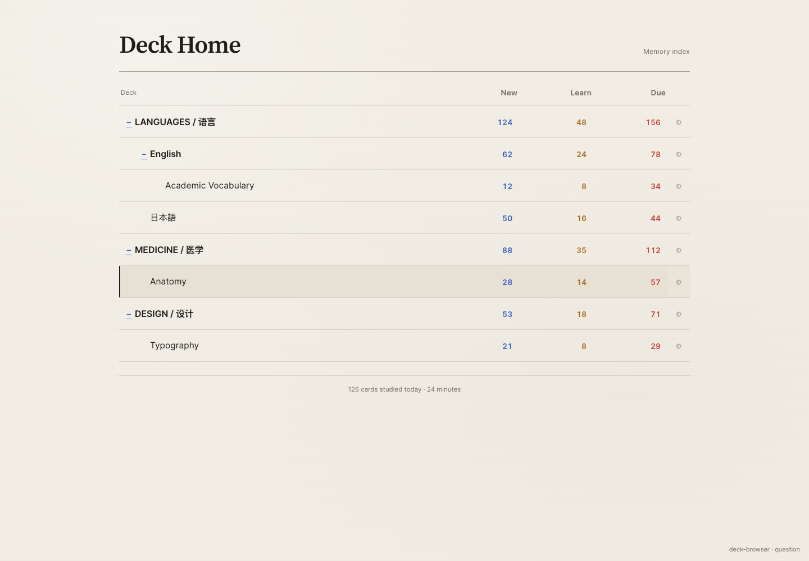
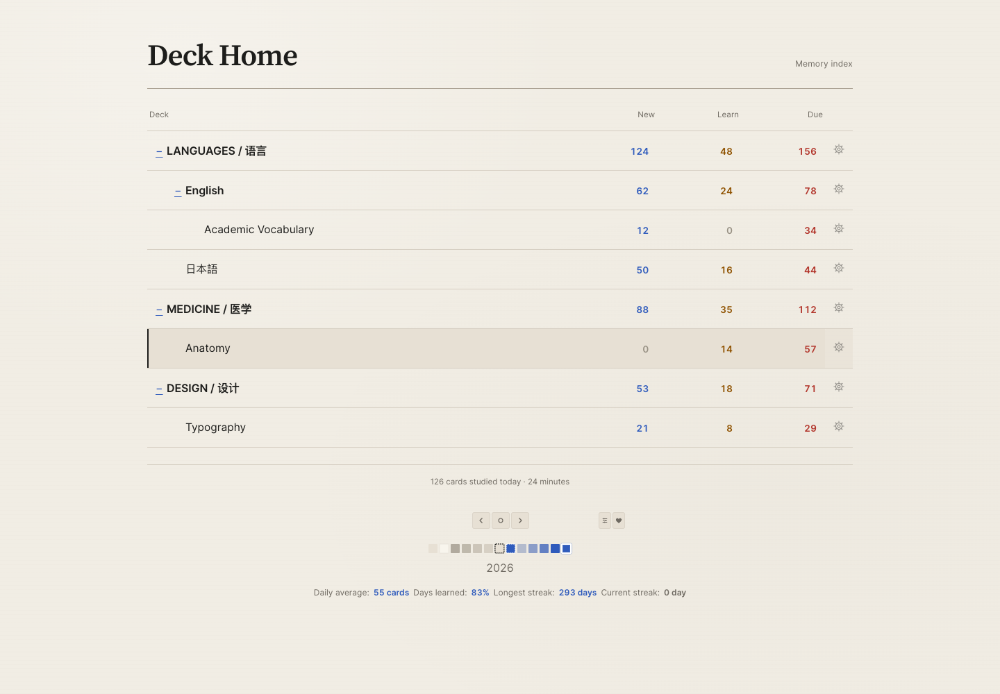
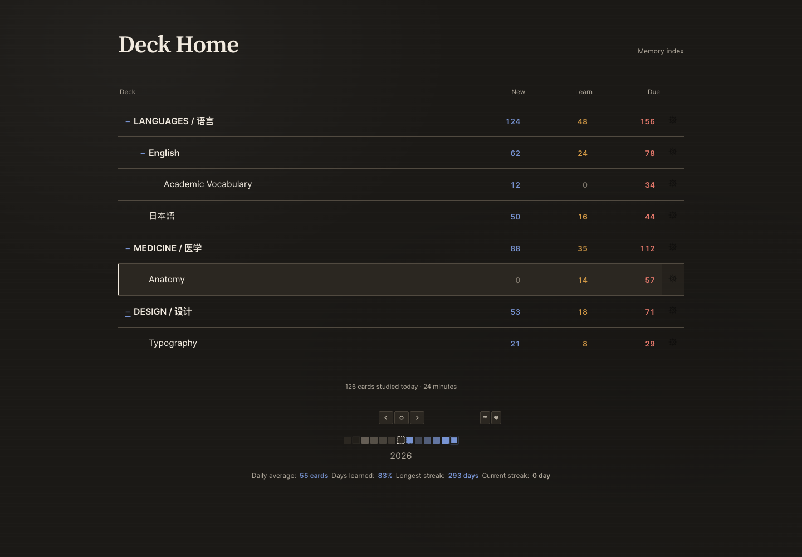
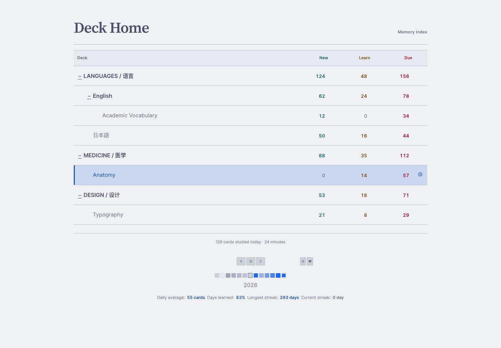
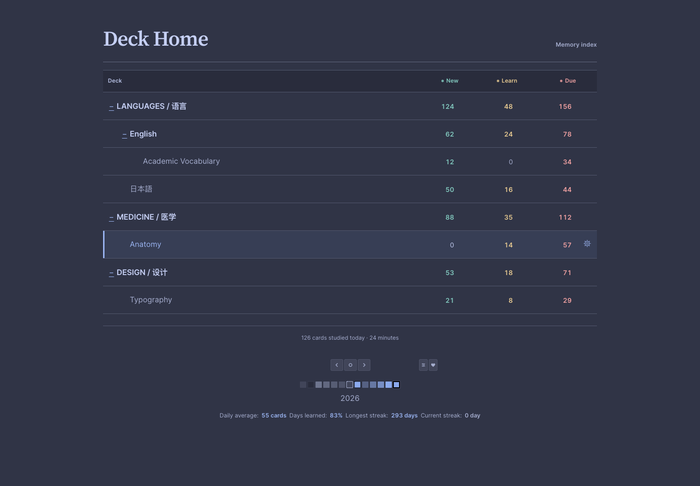
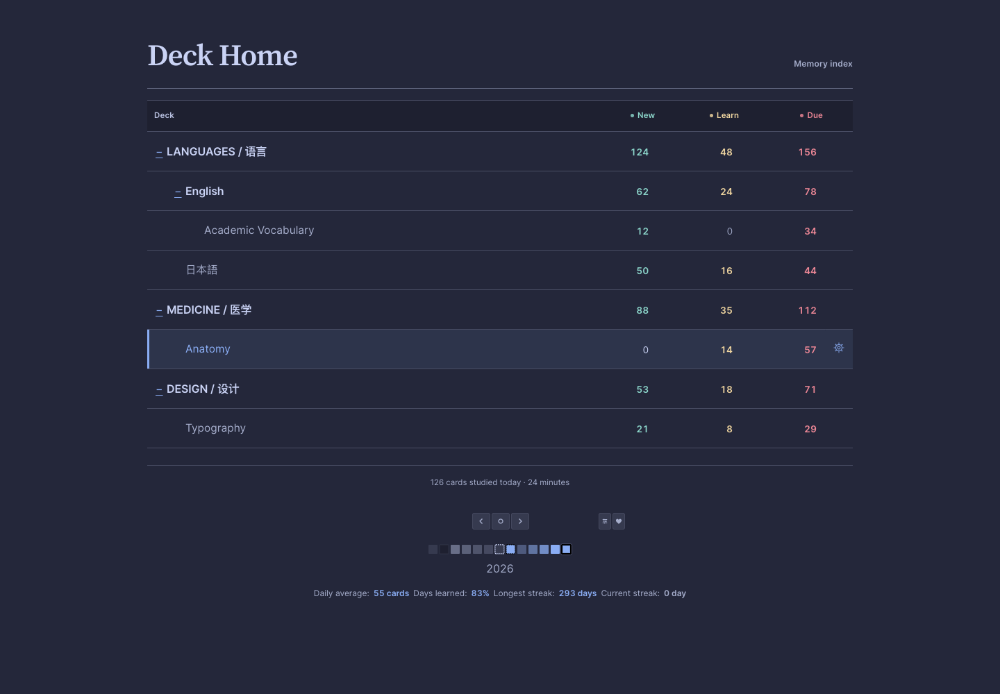
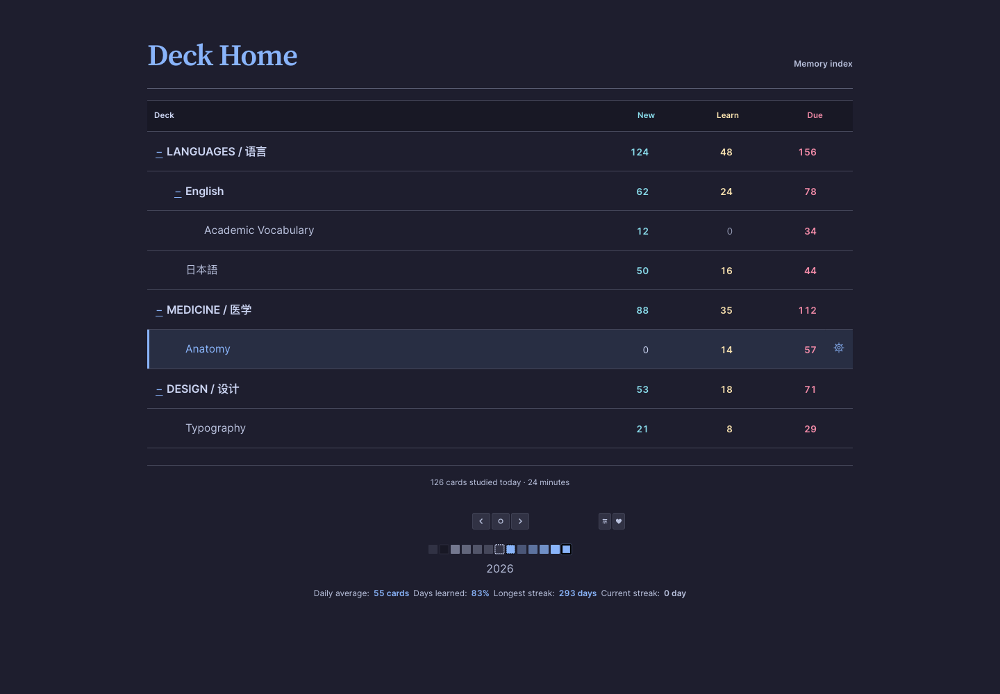
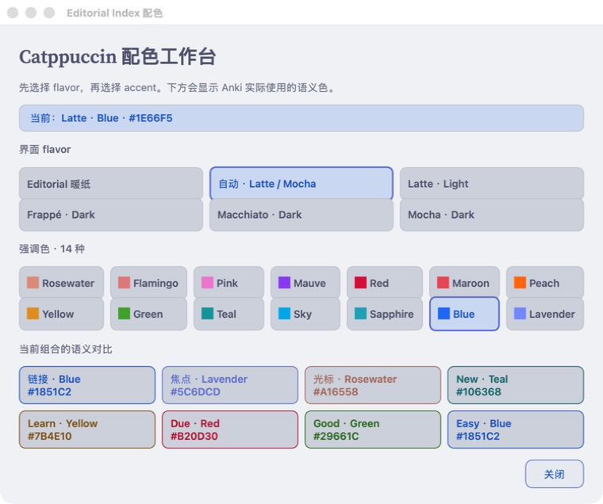
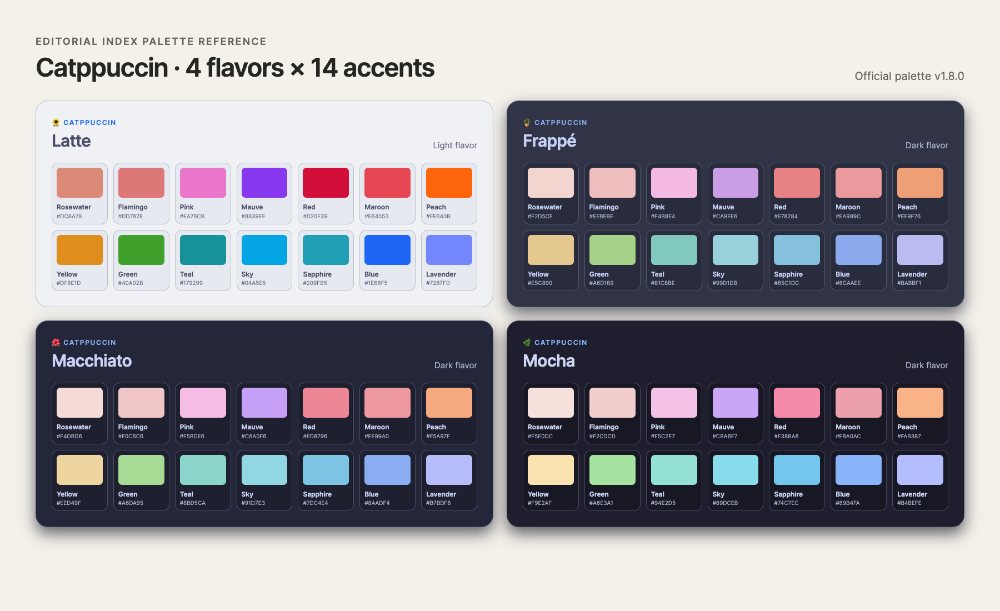
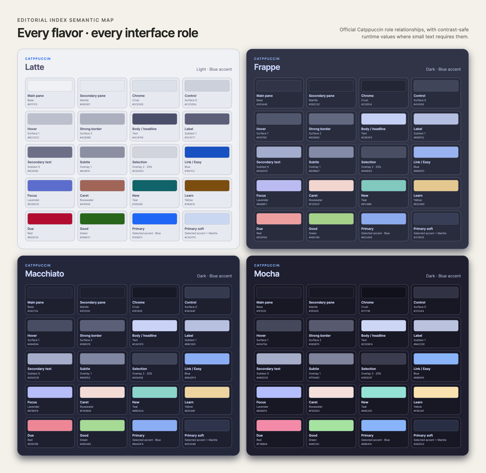

<div align="center">

# Editorial Index

一款给 Anki Desktop 使用的编辑索引主题，支持暖纸与 Catppuccin 配色

[English](./README.en.md) · [下载安装](https://github.com/Damon-GSY/anki-editorial-index/releases/latest) · [配置说明](./docs/CONFIGURATION.md) · [问题排查](./docs/TROUBLESHOOTING.md)

[](https://github.com/Damon-GSY/anki-editorial-index/releases/latest)
[](https://apps.ankiweb.net/)
[](./LICENSE)

</div>



Editorial Index 会把 Anki 的牌组页、复习外层界面、Add / Browse / Stats / Deck Options 等独立窗口与桌面菜单整理成克制的编辑索引风格。安装以后仍然使用原来的牌组、卡片和快捷键，也不会改动学习进度与调度算法。

## 下载与安装

1. 打开 [最新版本页面](https://github.com/Damon-GSY/anki-editorial-index/releases/latest)。
2. 在页面底部的 Assets 中下载 `Editorial-Index.ankiaddon`。
3. 打开 Anki Desktop，进入「工具 > 插件」。
4. 点击「从文件安装」，选择刚才下载的文件。
5. 重新启动 Anki。

安装成功后，「工具」菜单中会出现「Editorial Index 主题」、「Editorial Index 配色…」和「Editorial Index 快速配色」。前者是完整可视化工作台，后者适合直接切换。

完整步骤包括升级、卸载和校验下载文件，见 [安装指南](./docs/INSTALLATION.md)。

## 它会改变哪些地方

- 牌组首页和牌组树
- 牌组概览与「现在学习」按钮
- 顶部导航、普通底栏和复习评分区
- 复习卡片外层的阅读区域
- Add、Browse、Stats、Deck Options、Preferences 与其他 Anki 原生对话框
- Review Heatmap（如果已安装）的历史活动、未来到期、空白日、导航和提示颜色
- 原生菜单栏、菜单、状态栏、输入框、列表和标签页
- 日间模式与夜间模式

插件不会修改 Anki 数据库、牌组、笔记、卡片模板或 FSRS 调度。禁用或卸载后，Anki 会恢复原来的界面。


## 暖纸或 Catppuccin，随时切换

0.3.0 加入了完整的 Catppuccin 配色系统：Latte、Frappé、Macchiato、Mocha 四种 flavor，以及 Rosewater 到 Lavender 的全部 14 种强调色。「自动」会在 Anki 日间模式使用 Latte，夜间模式使用 Mocha。

新安装和从旧版升级都依然默认使用 Editorial Index 暖纸配色，不会自动切换到 Catppuccin。在「工具 → Editorial Index 配色…」选择 Catppuccin 后，主界面、复习页、Add / Browse Editor 和原生窗口会同步更新，无需重启，也不会重载正在编辑的内容。

色板是随插件打包的 [Catppuccin Palette v1.8.0](https://github.com/catppuccin/palette/blob/v1.8.0/palette.json) 官方 token 快照，语义关系参考 [Catppuccin 官方 Style Guide](https://github.com/catppuccin/catppuccin/blob/main/docs/style-guide.md)，切换时不会联网。四种 flavor 会同时切换 Base / Mantle / Crust、Surface、Overlay 和文字层级；链接固定使用 Blue、焦点使用 Lavender、光标使用 Rosewater，状态色也各自保留，不再全部跟随所选 accent。完整对应关系见 [Catppuccin 语义配色映射](./docs/CATPPUCCIN_MAPPING.md)。

### Editorial 暖纸

Editorial 保留纸张的温度和编辑排版感，会跟随 Anki 的日间与夜间模式。

| 日间模式 | 夜间模式 |
| --- | --- |
|  |  |

### Catppuccin 四种 flavor

下面四张实际界面统一使用 Blue 强调色，便于直接比较 flavor 本身完整的中性层、文字层级、功能色、对比和氛围。

| Latte · Light | Frappé · Dark |
| --- | --- |
|  |  |
| Macchiato · Dark | Mocha · Dark |
|  |  |

### 全部 14 种强调色

4 种 flavor 与 14 种强调色可任意组合，共 56 种 Catppuccin 选择。这里的“56 种”是 56 个可选组合，并不是在日常界面同时铺满 14 种强调色；一次只启用一个 accent，避免牌组页失去视觉层级。

在 Anki 中打开「工具 → Editorial Index 配色…」，会一次看到全部 14 种官方色值、当前 flavor、当前 accent 和实际语义对比。选择任意色块后会立即应用；「Editorial Index 快速配色」仍保留为紧凑入口。



下图用于横向核对四种 flavor 的全部官方原始色值；真实界面中的小字和焦点边框会在必要时自动使用可读性更高的派生色。



### 每种 flavor 的完整语义组合

这张表展示四种 flavor 如何分别组合 Base、Mantle、Crust、Surface、文字层、链接、焦点、光标与状态色。这里显示的是插件实际使用的运行时颜色；Latte 中需要承担小字的浅色会保留原色相并自动满足可读性要求。



## 配置

在 Anki 中进入「工具 > 插件」，选中 Editorial Index，再点击「配置」。保存后主界面、已打开的独立窗口与 Editor 会同步更新。

| 设置 | 默认值 | 用途 |
| --- | --- | --- |
| `enabled` | `true` | 控制整个主题是否启用 |
| `color_theme` | `editorial` | 选择 Editorial Index 暖纸或 Catppuccin 配色 |
| `accent_color` | `#2F5BBC` | 设置 Editorial Index 暖纸配色的强调色 |
| `catppuccin_flavor` | `auto` | 选择自动、Latte、Frappé、Macchiato 或 Mocha |
| `catppuccin_accent` | `blue` | 选择 14 种 Catppuccin 强调色之一 |
| `style_native_chrome` | `true` | 美化独立窗口、对话框、原生控件及其内嵌 Anki 页面 |
| `style_reviewer` | `true` | 美化复习卡片外层和评分区 |
| `animations` | `true` | 启用短促的出现与悬停动画 |

`accent_color` 只在 `color_theme` 为 `editorial` 时生效，并且只接受六位十六进制颜色，例如 `#2F5BBC`。Catppuccin 的可用 flavor、14 种强调色、JSON 示例和恢复方法都放在 [配置说明](./docs/CONFIGURATION.md) 中。

也可以不打开 JSON，直接使用「工具 → Editorial Index 配色…」查看全部选项，或使用「工具 → Editorial Index 快速配色」直接切换。

## 字体与卡片模板

界面操作文字使用 Inter，页面标题和复习阅读区域使用 Source Serif Pro。两套字体均随插件安装；中文、日文和韩文继续使用系统自带字体，避免缺字。

Editorial Index 只处理 Anki 官方界面拥有的区域。已有卡片模板中的字段排版仍由你的模板控制。想让卡片内容也使用配套样式，可以选择性安装 [`extras/card-template`](./extras/card-template/README.md)，这一步不会影响插件本身。

## 兼容范围

- 需要 Anki Desktop 25.09.4 或更高版本
- macOS 已完成本地安装验证
- Windows 与 Linux 使用相同的 Anki 插件接口，欢迎提交实际设备反馈
- 不适用于 AnkiMobile、AnkiDroid 或 AnkiWeb
- 其他界面主题可能覆盖同一组样式，建议一次只启用一个完整 UI 主题
- 已针对 Review Heatmap 1.0.1 的 SVG `q1–q20` 结构完成兼容；未安装该插件时不会产生额外界面或功能

Anki 更新有时会改变插件接口或页面结构。如果更新 Anki 后出现异常，请先查看 [问题排查](./docs/TROUBLESHOOTING.md)，再提交 [Issue](https://github.com/Damon-GSY/anki-editorial-index/issues/new/choose)。

## 隐私与安全

插件不发送网络请求，不收集使用数据，也不读取或修改卡片内容。它只加载安装包内的字体、样式和配色数据，并通过 Anki 官方插件钩子把样式应用到桌面界面。

从 GitHub 下载的发行文件会同时提供 SHA-256 校验值。安全说明见 [SECURITY.md](./SECURITY.md)。

## 开发

```bash
python3 scripts/package_addon.py
python3 scripts/validate_addon.py
python3 scripts/smoke_test_addon.py
python3 scripts/test_native_theme.py
python3 scripts/test_catppuccin_palette.py
npm ci
npx playwright install chromium
npm run test:ui
python3 -m pip install playwright==1.60.0
python3 scripts/test_catppuccin_web.py
```

源码位于 [`addon`](./addon/)，生成的安装包位于 [`dist/Editorial-Index.ankiaddon`](./dist/Editorial-Index.ankiaddon)。参与方式见 [CONTRIBUTING.md](./CONTRIBUTING.md)，每个版本的变化见 [CHANGELOG.md](./CHANGELOG.md)。

## 独立实现与许可

Editorial Index 是面向 Anki 的独立实现，不包含 BewlyCat、BewlyBewly 或 Bilibili 的源代码、图标、插画及其他素材，也未获相关项目或权利方背书。Catppuccin 配色使用官方 MIT 许可的 palette 数据，但语义映射、交互色和 Anki 集成均为本项目独立实现；本项目不是 Catppuccin 官方 port。完整边界说明见 [INDEPENDENT_DESIGN.md](./INDEPENDENT_DESIGN.md)。

项目源码按 [MIT License](./LICENSE) 发布。随插件分发的 Inter 与 Source Serif Pro 使用 [SIL Open Font License 1.1](./addon/web/fonts/OFL.txt)，Catppuccin Palette 快照使用其 [MIT License](./addon/CATPPUCCIN_LICENSE)。详见 [第三方声明](./addon/THIRD_PARTY_NOTICES.md)。Anki 及其他名称归各自权利方所有。
