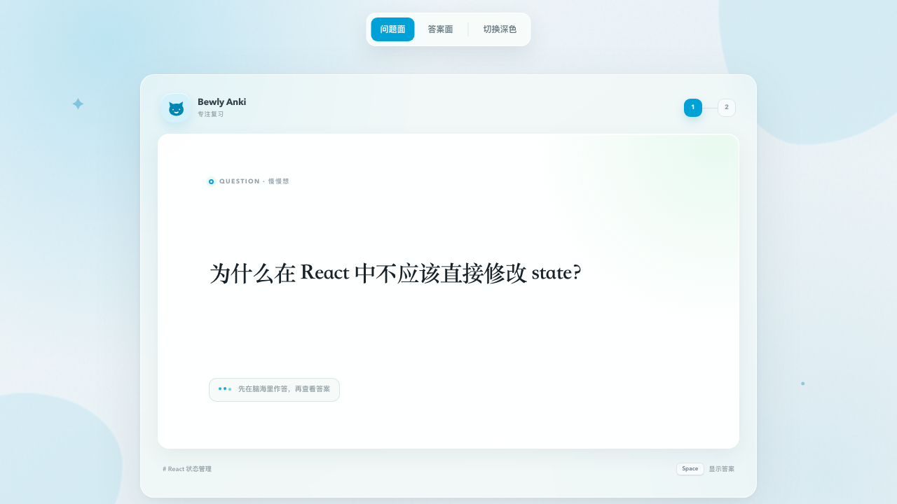
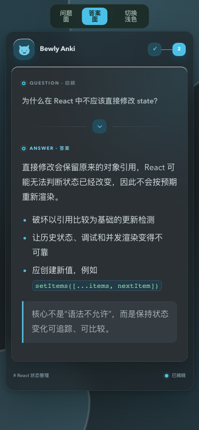

# Bewly Anki

一套参考 BewlyCat / BewlyBewly 视觉语言设计的 Anki 卡片模板。它保留了 Anki 的原生翻面与评分流程，只用 HTML + CSS 完成界面，不依赖网络字体、CDN、图片素材或运行时 JavaScript。





## 设计方向

- Bewly 标志性的青蓝色作为唯一强调色，降低长时间复习的视觉疲劳。
- 半透明外壳和实色内容面板形成层级；旧版 WebView 不支持毛玻璃时，内容仍然清楚。
- 猫咪标记由内联 SVG 绘制，不需要向 `collection.media` 添加文件。
- 问题面保持克制，答案面显示问题回顾与清晰分隔，避免翻面后失去上下文。
- 支持 Anki Desktop、AnkiMobile、AnkiDroid 的深色模式、窄屏布局、图片、表格、代码块、引用、列表和音频按钮。
- 所有动效都会尊重系统的“减少动态效果”设置。

## 文件

```text
template/
  front.html      # 正面模板
  back.html       # 背面模板
  styling.css     # Anki 样式
preview/
  index.html      # 可直接在浏览器打开的效果预览
  preview.css     # 仅供预览页使用
  preview.js      # 仅供预览页切面/切主题，不复制到 Anki
```

## 安装到 Anki

1. 打开 Anki，进入「浏览」。
2. 选择要应用的笔记类型，然后打开「卡片…」。
3. 将 [`template/front.html`](./template/front.html) 全部复制到「正面模板」。
4. 将 [`template/back.html`](./template/back.html) 全部复制到「背面模板」。
5. 将 [`template/styling.css`](./template/styling.css) 全部复制到「样式」。
6. 在卡片编辑窗口中分别预览正面和背面，再同步到移动端检查一次。

模板默认使用 `Front`、`Back` 两个字段，并读取 Anki 内置的 `Tags`。如果你的字段名不同，需要在两个 HTML 文件中统一替换：

| 默认字段 | 替换为你的字段 | 用途 |
| --- | --- | --- |
| `{{Front}}` | 例如 `{{问题}}` | 问题正文 |
| `{{Back}}` | 例如 `{{答案}}` | 答案正文 |
| `{{Tags}}` | 可保留 | Anki 内置标签 |

字段名区分大小写。替换字段输出时，也要同步替换相邻的条件标记，例如：

```html
{{#Front}}
  {{Front}}
{{/Front}}
```

改为：

```html
{{#问题}}
  {{问题}}
{{/问题}}
```

## 本地预览

直接打开 [`preview/index.html`](./preview/index.html)，可以：

- 切换问题面 / 答案面；
- 切换浅色 / 深色主题；
- 按空格键模拟 Anki 翻面。

预览页中的工具栏和 JavaScript 只用于展示，不属于 Anki 模板。

## 自定义

颜色和圆角都集中在 `styling.css` 顶部的 CSS 变量中。优先修改这些变量，不要逐项搜索颜色值：

```css
:root {
  --accent-500: #00a1d6;  /* 主强调色 */
  --ink-950: #182329;   /* 主文字 */
  --radius-shell: 20px; /* 外壳圆角 */
  --radius-card: 16px;  /* 内容卡片圆角 */
}
```

如果不想显示品牌文字，可以删除两个模板中的 `.study-brand`，但建议保留右侧的正反面指示器。

## 兼容性说明

- 不使用远程资源，因此离线复习不会丢样式。
- 核心内容不依赖 JavaScript；Anki 各客户端对模板 JavaScript 的兼容性并不稳定。
- 深色模式以 Anki 官方的 `.nightMode` 选择器为主，同时兼容部分客户端使用的 `.night_mode`。
- 答案前保留了 `id="answer"`，长卡片翻面后 Anki 可以自动滚动到答案位置。
- 图片排除了 Anki 的 `#star` 标记，并使用响应式尺寸规则；移动端不会被大图撑破。
- 毛玻璃和动画属于渐进增强；不支持时会退化成普通半透明面板。

## 参考

- [BewlyCat](https://github.com/keleus/BewlyCat)
- [BewlyBewly](https://github.com/BewlyBewly/BewlyBewly)
- [Anki 官方：卡片模板](https://docs.ankiweb.net/templates/intro.html)
- [Anki 官方：样式与平台差异](https://docs.ankiweb.net/templates/styling.html)
- [Anki 官方：媒体与同步](https://docs.ankiweb.net/media.html)

这套模板是独立实现，只借鉴参考项目的视觉方向，没有复制其代码或素材。
